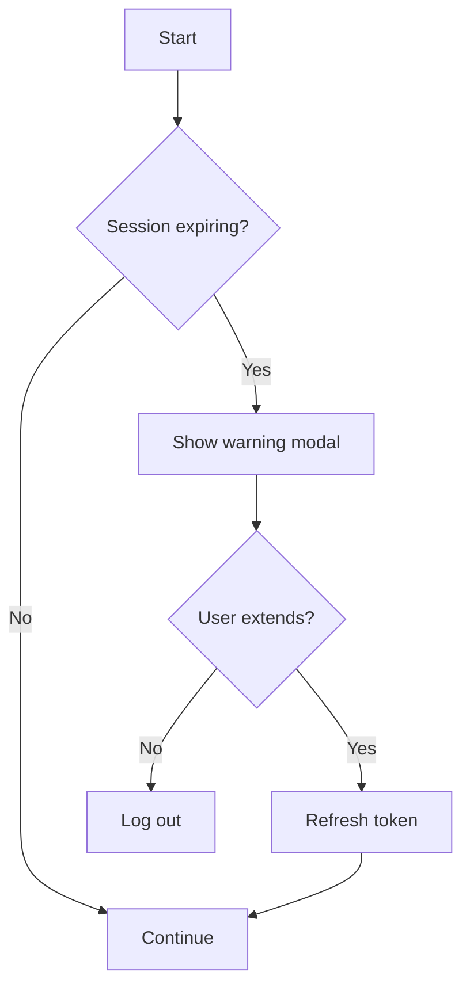
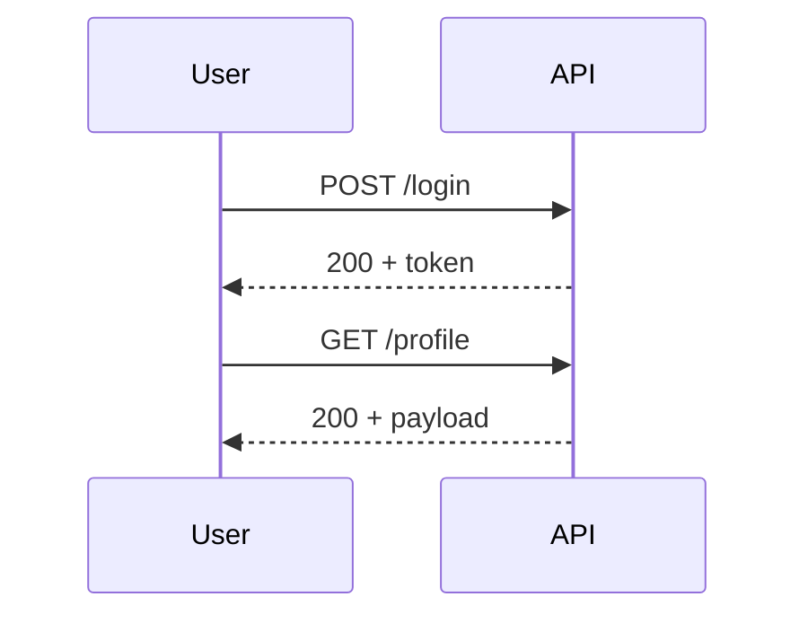

# 1. Markdown Viewer Validation Sheet

This document exercises every commonly supported Markdown feature. Each section states the
**expected** rendering so you can diff behaviour across viewers.

> **How to use:** open this file in the target viewer and walk the sections in order.
> Anything that renders as raw source text is unsupported by that viewer.

<!-- This is an HTML comment. It must NOT be visible in rendered output. -->

---

## 2. Headings

# H1 — Heading level 1
## H2 — Heading level 2
### H3 — Heading level 3
#### H4 — Heading level 4
##### H5 — Heading level 5
###### H6 — Heading level 6

####### H7 — seven hashes (should render as literal text, not a heading)

Setext H1
=========

Setext H2
---------

### Heading with `inline code`, **bold**, and [a link](https://example.com)

---

## 3. Paragraphs and line breaks

This is a single paragraph. These three source lines
should collapse into one continuous line
because they are separated by single newlines only.

This line ends with two trailing spaces  
so this line should appear directly beneath it as a hard break.

This line ends with a backslash\
so this line should also appear as a hard break.

This paragraph is separated by a blank line, so it is a **new paragraph** with vertical spacing above it.

A deliberately long line to test soft wrapping behaviour and horizontal overflow: Lorem ipsum dolor sit amet, consectetur adipiscing elit, sed do eiusmod tempor incididunt ut labore et dolore magna aliqua, ut enim ad minim veniam quis nostrud exercitation ullamco laboris nisi ut aliquip ex ea commodo consequat.

---

## 4. Emphasis and inline styles

| Syntax | Source | Expected |
|---|---|---|
| Italic (asterisk) | `*italic*` | *italic* |
| Italic (underscore) | `_italic_` | _italic_ |
| Bold (asterisk) | `**bold**` | **bold** |
| Bold (underscore) | `__bold__` | __bold__ |
| Bold + italic | `***both***` | ***both*** |
| Nested | `**bold with _italic_ inside**` | **bold with _italic_ inside** |
| Strikethrough (GFM) | `~~struck~~` | ~~struck~~ |
| Highlight (extension) | `==marked==` | ==marked== |
| Subscript (extension) | `H~2~O` | H~2~O |
| Superscript (extension) | `x^2^` | x^2^ |

Intraword underscores must **not** italicise: snake_case_variable_name and `MAX_RETRY_COUNT`.

Intraword asterisks **should** italicise in some flavours: un*frigging*believable.

Escaped literals: \*not italic\*, \_not italic\_, \`not code\`, \# not a heading, 5 \* 3 \= 15.

HTML entities: &copy; &amp; &lt;tag&gt; &nbsp; &mdash; &hellip; &rarr; &#8721;

---

## 5. Inline code

Basic inline code: `const x = 42;`

Inline code with special characters: `a > b && c < d || !e`, `SELECT * FROM [dbo].[User]`, `<div class="x">`

Inline code containing a backtick: `` git commit -m "use `npm ci` here" ``

Inline code containing double backticks: ``` a ``b`` c ```

Markdown inside code must stay literal: `**not bold**`, `_not italic_`, `[not a link](x)`

Inline code preserving    multiple    spaces: `word    word`

Adjacent code spans: `first``second` — should render as two separate spans.

---

## 6. Fenced code blocks

### 6.1 No language specified

```
Plain preformatted block.
    Indentation is preserved.
Special chars: < > & " ' ` \ | * _ #
No syntax highlighting expected.
```

### 6.2 JavaScript

```javascript
// Debounce with a trailing-edge invoke
export function debounce(fn, wait = 300) {
  let timer = null;
  return (...args) => {
    clearTimeout(timer);
    timer = setTimeout(() => fn.apply(this, args), wait);
  };
}

const log = (msg) => console.log(`[${new Date().toISOString()}] ${msg}`);
log("ready");
```

### 6.3 TypeScript

```typescript
interface SessionWarning {
  readonly expiresAt: Date;
  warnBeforeMs: number;
  onExpire?: () => void;
}

function isExpiring({ expiresAt, warnBeforeMs }: SessionWarning): boolean {
  return expiresAt.getTime() - Date.now() <= warnBeforeMs;
}
```

### 6.4 Python

```python
from dataclasses import dataclass, field


@dataclass(frozen=True, slots=True)
class Sample:
    """Docstring with a 'quote' and a "double quote"."""

    name: str
    tags: list[str] = field(default_factory=list)

    def slug(self) -> str:
        return self.name.strip().lower().replace(" ", "-")


if __name__ == "__main__":
    print(Sample("Hello World", ["a", "b"]).slug())
```

### 6.5 C#

```csharp
using System.Text.Json.Serialization;

namespace Fcid.Utilities;

public sealed record ExportRequest(
    [property: JsonPropertyName("id")] Guid Id,
    string FileName,
    IReadOnlyList<string> Columns)
{
    public string Describe() =>
        $"Export {Id:N} -> {FileName} ({Columns.Count} columns)";
}
```

### 6.6 SQL

```sql
WITH ranked AS (
    SELECT
        u.UserId,
        u.Email,
        ROW_NUMBER() OVER (PARTITION BY u.TenantId ORDER BY u.CreatedUtc DESC) AS rn
    FROM dbo.[User] AS u
    WHERE u.IsActive = 1
      AND u.CreatedUtc >= DATEADD(DAY, -30, SYSUTCDATETIME())
)
SELECT UserId, Email
FROM ranked
WHERE rn <= 5
ORDER BY Email;
```

### 6.7 Bash

```bash
#!/usr/bin/env bash
set -euo pipefail

TARGET="${1:-./dist}"
for f in "$TARGET"/*.log; do
  [[ -e "$f" ]] || continue
  printf '%s -> %d lines\n' "$f" "$(wc -l < "$f")"
done
```

### 6.8 PowerShell

```powershell
$ErrorActionPreference = 'Stop'

$origins = @('https://dev.example.com', 'https://stage.example.com')
foreach ($origin in $origins) {
    $res = Invoke-WebRequest -Uri "$origin/api/health" -Method Options -SkipHttpErrorCheck
    Write-Host ("{0,-40} {1}" -f $origin, $res.StatusCode) -ForegroundColor Cyan
}
```

### 6.9 JSON

```json
{
  "name": "markdown-test",
  "version": "1.0.0",
  "nested": { "array": [1, 2.5, -3, 1e10], "bool": true, "nothing": null },
  "escaped": "line\nbreak \"quoted\" and a \\backslash\\",
  "unicode": "caf\u00e9"
}
```

### 6.10 YAML

```yaml
version: "3.9"
services:
  api:
    image: mcr.microsoft.com/dotnet/aspnet:10.0
    environment:
      - ASPNETCORE_ENVIRONMENT=Development
    ports: ["8080:8080"]
    healthcheck:
      test: ["CMD", "curl", "-f", "http://localhost:8080/health"]
  block_scalar: |
    literal line one
    literal line two
  folded_scalar: >
    folded into
    a single line
```

### 6.11 HTML

```html
<!DOCTYPE html>
<html lang="en">
  <head>
    <meta charset="utf-8" />
    <title>Sample &amp; Test</title>
  </head>
  <body>
    <p class="lead" data-id="1">Hello &lt;world&gt;</p>
  </body>
</html>
```

### 6.12 CSS

```css
:root {
  --accent: #3b82f6;
  --radius: 0.5rem;
}

.card:not(.is-disabled)::after {
  content: "→";
  background: linear-gradient(135deg, var(--accent) 0%, #1e40af 100%);
  border-radius: var(--radius);
}

@media (prefers-color-scheme: dark) {
  .card { color: #f9fafb; }
}
```

### 6.13 Vue (SFC)

```vue
<template>
  <div v-if="visible" class="modal" role="dialog" :aria-label="title">
    <p>{{ secondsRemaining }}s remaining</p>
    <button @click="$emit('extend')">Stay signed in</button>
  </div>
</template>

<script setup>
import { ref, computed } from 'vue'

const props = defineProps({ title: { type: String, default: 'Session' } })
const secondsRemaining = ref(60)
const visible = computed(() => secondsRemaining.value > 0)
</script>

<style scoped>
.modal { padding: 1rem; }
</style>
```

### 6.14 JSX

```jsx
export default function Badge({ count = 0, children }) {
  return (
    <span className={count > 9 ? "badge badge--lg" : "badge"}>
      {children} {count > 99 ? "99+" : count}
    </span>
  );
}
```

### 6.15 XML

```xml
<?xml version="1.0" encoding="utf-8"?>
<configuration>
  <appSettings>
    <add key="Timeout" value="30" />
    <!-- comment inside XML -->
  </appSettings>
  <![CDATA[ raw <not>parsed</not> ]]>
</configuration>
```

### 6.16 Diff

```diff
--- a/src/api.ts
+++ b/src/api.ts
@@ -1,6 +1,7 @@
 const BASE = "/api/v1";
-export async function get(path) {
-  return fetch(BASE + path);
+export async function get(path: string, init?: RequestInit) {
+  const res = await fetch(`${BASE}${path}`, init);
+  if (!res.ok) throw new Error(`HTTP ${res.status}`);
+  return res.json();
 }
```

### 6.17 Unknown language (graceful fallback expected)

```klingon-script
tlhIngan maH! { qapla' := true; }
```

### 6.18 Tilde-delimited fence

~~~python
print("Fenced with tildes instead of backticks")
~~~

### 6.19 Nested fences (outer uses four backticks)

````markdown
Here is how you write a fenced block in Markdown:

```python
print("inner block")
```
````

### 6.20 Indented code block (four spaces, no fence)

    #include <stdio.h>

    int main(void) {
        printf("indented code block\n");
        return 0;
    }

### 6.21 Fence with line-highlight metadata (extension)

```js {2,4-5}
const a = 1;
const b = 2; // highlighted
const c = 3;
const d = 4; // highlighted
const e = 5; // highlighted
```

---

## 7. Lists

### 7.1 Unordered, nested three deep

- Level 1 item A
  - Level 2 item A1
    - Level 3 item A1a
      - Level 4 item A1a-i
- Level 1 item B
* Asterisk marker (may start a new list)
+ Plus marker (may start a new list)

### 7.2 Ordered

1. First
2. Second
3. Third
   1. Nested 3.1
   2. Nested 3.2
      1. Nested 3.2.1

### 7.3 Ordered starting at a custom number

7. Seven
8. Eight
9. Nine

### 7.4 All-ones numbering (should auto-increment)

1. One
1. Two
1. Three

### 7.5 Tight vs loose

Tight list (no `<p>` wrappers, minimal spacing):

- alpha
- beta
- gamma

Loose list (blank lines between items → paragraph spacing):

- alpha

- beta

- gamma

### 7.6 Mixed nesting with multi-block items

1. Item with a paragraph continuation.

   This second paragraph belongs to item 1 and must stay indented under it.

2. Item containing a code block:

   ```bash
   echo "nested inside a list item"
   ```

3. Item containing a nested unordered list and a blockquote:

   - sub-item one
   - sub-item two

   > Blockquote nested inside a list item.

4. Item containing a table:

   | Key | Value |
   |---|---|
   | a | 1 |
   | b | 2 |

---

## 8. Task lists (checkboxes)

- [x] Completed task
- [ ] Incomplete task
- [X] Completed with uppercase X
- [ ] Task with **bold**, `code`, and a [link](https://example.com)
- [ ] Parent task with children
  - [x] Child done
  - [ ] Child pending
    - [x] Grandchild done
- [ ] ~~Cancelled task rendered with strikethrough~~

Ordered task list (support varies):

1. [x] Step one complete
2. [ ] Step two pending

Not a task list (no space in brackets) — should render literally: `-[x] broken`

-[x] broken

---

## 9. Tables

### 9.1 Basic

| Column A | Column B | Column C |
|----------|----------|----------|
| A1 | B1 | C1 |
| A2 | B2 | C2 |

### 9.2 Alignment

| Left aligned | Centered | Right aligned | Default |
|:-------------|:--------:|--------------:|---------|
| left | center | right | default |
| 1 | 22 | 333 | 4444 |
| longer cell value | x | 1,234.56 | — |

### 9.3 Inline formatting, escaped pipes, and empty cells

| Feature | Example | Notes |
|---|---|---|
| Bold | **bold text** | works |
| Italic | *italic text* | works |
| Code | `x \| y` | pipe inside code |
| Escaped pipe | a \| b | literal pipe |
| Link | [example](https://example.com "Title") | with title |
| Strikethrough | ~~gone~~ | GFM |
| Empty cell | | ← this cell is empty |
| Multi-word | one two three four five | wrapping test |

### 9.4 Ragged source alignment (must still render correctly)

| Short | A much longer header cell | X |
|---|---|---|
| 1 | value | y |
| 2 | another value here | z |

### 9.5 Single column and wide table

| Only |
|---|
| one |

| C1 | C2 | C3 | C4 | C5 | C6 | C7 | C8 | C9 | C10 |
|---|---|---|---|---|---|---|---|---|---|
| 1 | 2 | 3 | 4 | 5 | 6 | 7 | 8 | 9 | 10 |
| aaaa | bbbb | cccc | dddd | eeee | ffff | gggg | hhhh | iiii | jjjj |

---

## 10. Blockquotes

> Simple blockquote on a single line.

> Multi-line blockquote where the second source line
> continues the same paragraph.

> First paragraph of a blockquote.
>
> Second paragraph of the same blockquote.

> Level 1
>> Level 2
>>> Level 3

> ### Heading inside a blockquote
>
> - list item inside a blockquote
> - another item
>
> ```python
> print("code fence inside a blockquote")
> ```
>
> | col | col |
> |---|---|
> | a | b |
>
> — Attribution line with **bold**

### 10.1 GitHub-style alerts / callouts

Each block below is a GitHub alert, not a plain blockquote. The first line is only the label. That label must not appear as body text. The title is the type name with a capital first letter, plus an icon. The left border and the title color differ by type: Note blue, Tip green, Important purple, Warning amber, Caution red.

> [!NOTE]
> Highlights information that users should take into account, even when skimming.

> [!TIP]
> Optional information to help a user be more successful.

> [!IMPORTANT]
> Crucial information necessary for users to succeed.

> [!WARNING]
> Critical content demanding immediate user attention due to potential risks.

> [!CAUTION]
> Negative potential consequences of an action.

### 10.2 Content inside an alert

Expected: one Warning callout. The list stays a list. `code` and **bold** stay inline formatting. The fence is a code block, and a fence with no language is plain text.

> [!WARNING]
> - Check the list
> - Then check `code` and **bold**
>
> ```
> plain fence inside an alert
> ```

### 10.3 Text that must stay a blockquote

Expected: ordinary blockquotes. The bracket text stays visible.

> [!NOTE] same line stays a quote

> [!note]
> A lowercase label stays a quote.

> [!CUSTOM]
> An unknown label stays a quote.

> hello
>
> [!NOTE]
> A label that is not on the first line stays a quote.

---

## 11. Links

- Inline: [Example site](https://example.com)
- Inline with title: [Example site](https://example.com "Hover title text")
- Relative path: [local file](./docs/readme.md)
- Anchor to a heading in this document: [jump to Tables](#9-tables)
- Reference style: [reference link][ref-1]
- Collapsed reference: [ref-2][]
- Shortcut reference: [ref-3]
- Autolink: <https://example.com/autolink>
- Email autolink: <someone@example.com>
- Bare URL (GFM autolinks this): https://example.com/bare
- Link with parentheses in URL: [wiki](https://en.wikipedia.org/wiki/Markdown_(disambiguation))
- Link with spaces in URL: [spaced](https://example.com/a%20b)
- Link wrapping **bold** and `code`: [**bold `code` link**](https://example.com)
- Empty-target link: [no href]()
- Not a link (escaped): \[not a link\](https://example.com)

[ref-1]: https://example.com/reference-one "Reference One"
[ref-2]: https://example.com/reference-two
[ref-3]: https://example.com/reference-three

---

## 12. Images

Inline image with alt text and title:


Small inline image in a sentence:  ← should sit inline.

Reference-style image:

![Reference image][img-ref]

Clickable image (image wrapped in a link):

[](https://example.com)

Broken image (must show alt text, not crash):


Sized image via HTML:


[img-ref]: https://placehold.co/500x150/png "Reference-style image title"

---

## 13. Horizontal rules

Three hyphens:

---

Three asterisks:

***

Three underscores:

___

Spaced hyphens:

- - -

---

## 14. Definition lists (extension)

Term one
: Definition of term one.

Term two
: First definition of term two.
: Second definition of term two.

`API`
: Application Programming Interface — definition containing `inline code` and **bold**.

---

## 15. Footnotes (extension)

Here is a statement needing a citation.[^1] Here is another one.[^note-label]

Inline footnote syntax (rare): ^[This is an inline footnote.]

[^1]: The first footnote definition.
[^note-label]: A named footnote with **formatting**, `code`, and a [link](https://example.com).

    It also has a second indented paragraph.

---

## 16. Math (LaTeX extension)

Inline math: the mass–energy relation is $E = mc^2$, and $\alpha + \beta = \gamma$.

Alternate inline delimiters: \(a^2 + b^2 = c^2\)

Block math:

$$
\int_{0}^{\infty} e^{-x^2}\,dx = \frac{\sqrt{\pi}}{2}
$$

$$
\begin{aligned}
f(x) &= ax^2 + bx + c \\
f'(x) &= 2ax + b
\end{aligned}
$$

Fenced math block:

```math
\sum_{i=1}^{n} i = \frac{n(n+1)}{2}
```

Currency should not be parsed as math: it costs $5 and then $10 total.

---

## 17. Diagrams (Mermaid extension)





---

## 18. Inline and block HTML

Inline HTML: <strong>strong</strong>, <em>emphasis</em>, <code>code element</code>,
<kbd>Ctrl</kbd> + <kbd>Shift</kbd> + <kbd>P</kbd>, <mark>highlighted</mark>,
<abbr title="HyperText Markup Language">HTML</abbr>, H<sub>2</sub>O, x<sup>2</sup>,
<u>underlined</u>, <small>small text</small>, <br /> and a line break above.

Collapsible section:

<details>
<summary>Click to expand — contains Markdown inside</summary>

Hidden content with a **bold word**, a list, and code:

- item one
- item two

```python
print("inside details")
```

</details>

Raw HTML table with a caption:

<table>
  <caption>HTML table caption</caption>
  <thead>
    <tr><th>Header 1</th><th>Header 2</th></tr>
  </thead>
  <tbody>
    <tr><td>Cell 1</td><td>Cell 2</td></tr>
    <tr><td colspan="2">Spanning cell</td></tr>
  </tbody>
</table>

Div with inline styles (may be stripped by sanitising viewers):

<div style="padding: 8px; border-left: 4px solid #3b82f6;">
  Styled block-level HTML.
</div>

Script tag (must be neutralised, never executed):

<script>console.log("This must not run.");</script>

---

## 19. Unicode, emoji, and directionality

Emoji literals: 🎉 ✅ ⚠️ 🚀 🐛 👍🏽 👨‍👩‍👧‍👦 🏳️‍🌈

Emoji shortcodes (extension): :tada: :white_check_mark: :warning: :rocket:

Accents and scripts: café, naïve, Ångström, Ελληνικά, Русский, 中文, 日本語, 한국어, தமிழ், עברית, العربية

Right-to-left paragraph: مرحبا بالعالم، هذا اختبار للنص من اليمين إلى اليسار.

Symbols: → ← ↔ ⇒ ≠ ≤ ≥ ± × ÷ ∞ ∑ ∏ √ ° © ® ™ § ¶ † ‡ • … — –

Zero-width and combining marks: a‌b (ZWNJ between a and b), é (e + combining acute).

Wide/monospace alignment check inside code:

```
| ASCII    | 中文     | emoji |
| abcdefgh | 中文中文 | 🎉🎉  |
```

---

## 20. Edge cases and stress tests

Heading immediately followed by a list with no blank line:
### Tight heading
- item after heading

Table immediately after a paragraph with no blank line:
| A | B |
|---|---|
| 1 | 2 |

List immediately followed by a fence with no blank line:
- last item
```
fence directly after list
```

Text with unclosed emphasis: this *is not closed properly.

Text with a lone underscore: 5_000 and a_b_c.

Hash not a heading: C# and #hashtag mid-sentence.

Numbers that look like a list: 2024. That year was fine.

Angle brackets in prose: use <T> as a type parameter, and 3 < 5 > 1.

Ampersand in prose: R&D, AT&T, and &notanentity;.

Backslash line: C:\Users\Abacus\Documents\file.txt

Trailing whitespace preservation inside code:

```
line with trailing spaces →   
tab	separated	values
```

Very long unbroken token (overflow test):

`aaaaaaaaaaaaaaaaaaaaaaaaaaaaaaaaaaaaaaaaaaaaaaaaaaaaaaaaaaaaaaaaaaaaaaaaaaaaaaaaaaaaaaaaaaaaaaaaaaaaaaaaaaaaaaaa`

Very long URL:

https://example.com/very/long/path/segment/one/two/three/four/five/six/seven/eight/nine/ten?query=value&another=value&third=value#fragment-identifier

---

## 21. Validation checklist

- [ ] All six heading levels render distinctly; seven hashes render literally
- [ ] Hard breaks work via both two spaces and a trailing backslash
- [ ] Soft-wrapped source lines join into one paragraph
- [ ] Bold, italic, strikethrough, and nested combinations all render
- [ ] `snake_case_names` are not italicised
- [ ] Escaped characters render literally
- [ ] Inline code preserves markup and handles embedded backticks
- [ ] Every fenced language is highlighted; unknown languages degrade gracefully
- [ ] Nested fences (four-backtick outer) render correctly
- [ ] Indented four-space code blocks render as code
- [ ] Lists nest at least four levels; tight and loose spacing differ
- [ ] Multi-block list items (paragraph, code, quote, table) stay indented
- [ ] Checkboxes render as boxes, checked and unchecked, including nested
- [ ] Table alignment markers are honoured
- [ ] Escaped pipes and pipes inside code do not break tables
- [ ] Blockquotes nest and contain headings, lists, code, and tables
- [ ] GitHub alerts (Note, Tip, Important, Warning, Caution) render as styled callouts with an icon and a capitalised title; the `[!TYPE]` line is not body text
- [ ] An alert can contain a list, inline formatting, and a code fence
- [ ] A marker on the same line as other text, a lowercase marker, an unknown label, or a marker that is not the first line stays a normal blockquote
- [ ] All link styles resolve; heading anchors jump correctly
- [ ] Images load; broken images show alt text
- [ ] Horizontal rules render for all four syntaxes
- [ ] Definition lists render as definitions
- [ ] Footnotes render with working back-references
- [ ] LaTeX math renders inline and as blocks; `$5` stays currency
- [ ] Mermaid diagrams render as graphics
- [ ] Safe inline HTML renders; `<script>` is neutralised
- [ ] `<details>` collapses and expands with Markdown inside
- [ ] Emoji, CJK, and RTL text render without layout breakage
- [ ] YAML front matter is hidden or rendered as metadata, not body text
- [ ] HTML comments are hidden
- [ ] Long tokens and long URLs wrap or scroll without breaking layout
- [ ] Dark mode is legible, including code blocks and tables

---

*End of validation sheet.*
